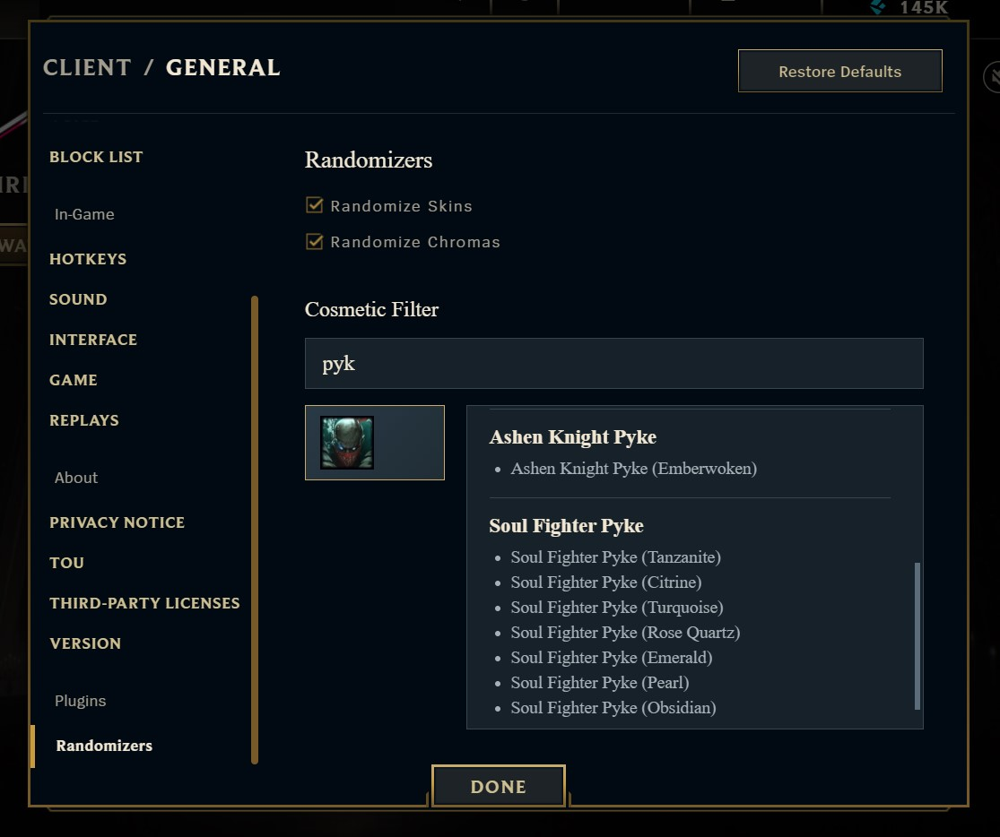

# League of Legends Skin and Chroma Randomizer
Annoyed by the lack of customization features in League of Legends champion select? This simple [Pengu](https://github.com/PenguLoader) plugin allows you to customize skin and chroma randomization in Summoner's Rift, ARAM, and Arena.

## Usage
1. Place this folder in Pengu Loader's `plugins` directory.
2. Start League of Legends with Pengu Loader.
3. Enable Pengu Loader.
4. In League of Legends Launcher Settings:
    - Enable **Randomize Skins** to select a random owned skin.
    - Enable **Randomize Chromas** to select a random owned chroma.
    - Use the champion list to exclude specific skins or chromas from random selection.

## Screenshot
